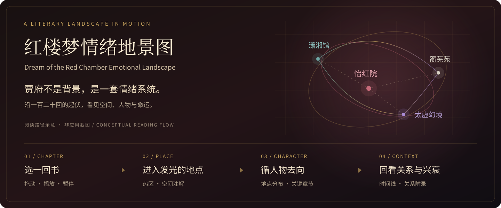

<div align="center">

<a id="english"></a>

# Dream of the Red Chamber Emotional Landscape

**English** · [简体中文](README.md)

**红楼梦情绪地景图**

Begin at chapter 27 and follow the characters and places as the chapters change.

[](package.json)

[Start locally](#start) · [What to explore](#explore) · [Reading the data](#interpretation) · [Development and content](#develop)

</div>

<p align="center">
  
</p>

This interactive web project rereads *Dream of the Red Chamber* through **space**. Move through chapters 1–120 and watch places light up with the narrative. Follow where characters appear, gather, part and go next to see how the same garden holds different emotions. The map is the main experience; character cards, the timeline and the relationship graph provide supporting views.

The interface and literary commentary are primarily in Chinese.

> **Full-spoiler warning: includes plot details and the novel's ending.** This is an interpretive literary visualization. It does not provide full-text search of the novel, automated sentiment analysis or a historically verified architectural reconstruction. The illustration above shows a conceptual reading path, not a screenshot of the running application.

<a id="explore"></a>
## From a chapter into the garden

### A first visit

1. **Begin at chapter 27.** `/atlas` opens at chapter 27 by default. Start with the chapter title, character locations and glowing places.
2. **Open a place.** Read the short spatial interpretations and notes on fate for places such as 潇湘馆 (Xiaoxiang Guan), 怡红院 (Yihong Yuan) and 蘅芜苑 (Hengwu Yuan), then return to the chapter's context.
3. **Let the chapters flow.** Drag the chapter bar, or use play, pause and 1× / 3× speed. Open the hotspots panel to compare the three brightest places in the current chapter.
4. **Follow a character.** Click 「人物」 (Characters) in the upper-right corner to see the main characters' annotated location distributions, key chapters and other characters appearing in the same chapter. Jump back to a corresponding place or chapter.

### Beyond the map

| Reading view | Local route | What you can do |
| --- | --- | --- |
| Chapter heatmap | `/atlas` | Play or scrub through 120 chapters to view place intensity, character locations and spatial commentary |
| Chapter timeline | `/timeline` | Switch between the early, middle and late periods to explore selected events and the places and characters they affect |
| Character emotion cards | `/characters` | Search by character, emotion or symbol, then open a map location or character relationships |
| Character relationship appendix | `/relations` | Select a character or relationship line to explore intimacy, conflict, power, dependence, misunderstanding and bonds of fate |
| About the project | `/about` | Read about the project's approach to spatial storytelling |

The map uses SVG, CSS lighting, seasonal symbols and chapter-specific effects; the relationship appendix uses a D3 layout. These views support reading and comparison without treating a literary interpretation as the only possible answer.

<a id="start"></a>
## Run locally

**Requirements: Node.js ≥ 20.9.0 and npm ≥ 10.** See [REQUIREMENTS.md](REQUIREMENTS.md) for the full requirements.

```bash
git clone https://github.com/yuzhang-zhong/Dream-of-the-Red-Chamber-Emotional-Map.git
cd Dream-of-the-Red-Chamber-Emotional-Map
npm ci
npm run dev
```

Open **http://localhost:3000/atlas**. The home page is at **http://localhost:3000**. If the terminal reports that the port is already in use, use the address it actually prints.

- No database, login system, account or external AI API key is required.
- The current experience runs on structured content in the repository, with no online model inference.
- The initial installation needs network access to download npm dependencies. The project loads Geist fonts through `next/font/google`, so compilation also needs access to the corresponding font resources.
- For production mode, build first, then start:

```bash
npm run build
npm run start
```

<a id="interpretation"></a>
## Where does the heat come from?

**Brightness is a reading cue, not an objective measurement of emotion.** The current implementation combines authored content with deterministic rules; heat is not inferred by an AI sentiment model.

| What you see | Current implementation | Limits when reading it |
| --- | --- | --- |
| Place intensity | Key chapters and intensity values in the [place data](src/data/atlas.ts), smoothed into neighboring chapters with a [Gaussian decay function](src/lib/atlas.ts) | 0–100 is visual intensity, not model confidence, word frequency or a measured emotion score |
| Characters and places in each chapter | The [chapter appearance mapping](src/data/chapter-appearances.ts) combines manual mappings for selected chapters, alias matching against chapter titles and fallback character groups when no match is found; at most 6 characters are shown per chapter | This is neither sentence-by-sentence extraction nor a complete cast list; a default location may indicate a symbolic affiliation |
| Character movements and co-occurrence | The [character analytics logic](src/lib/character-analytics.ts) aggregates the chapter annotations described above | Percentages and co-occurrence counts describe the project's annotations, not every activity in the novel or the actual strength of a relationship |
| Seasonal atmosphere | The [seasonal rules](src/data/chapter-seasons.ts) infer seasons from chapter-title keywords and chapter ranges | These heuristics create atmosphere and should not be treated as a precise reconstruction of the novel's chronology |
| Interpretations of space, emotion and relationships | Authored emotion entries, relationships, descriptions and selected events in the [base content](src/data/atlas.ts) | These form the project's interpretive framework; the map layout is not a geographic or architectural survey, and commentary should not be cited as quotations from the novel |

Chapter navigation covers 1–120, but the density of manual annotation varies between chapters. For teaching, research or an argument, return to your chosen edition of the novel to check the plot, original wording and chapter evidence. The current data is not an exhaustive scholarly annotation set with complete source references.

<a id="develop"></a>
## Development and content maintenance

### Stack and directory layout

Next.js **16.2.4** App Router · React **19.2.4** · TypeScript · Tailwind CSS **4** · D3 · Framer Motion · Lucide React

```text
src/
├── app/                     # 页面与只读 API 路由
├── components/
│   ├── atlas/               # 章节播放、园林地图与分析面板
│   ├── characters/          # 可搜索人物卡
│   ├── relations/           # D3 人物关系附录
│   ├── timeline/            # 分期事件时间线
│   └── visual-effects/      # 氛围与视觉层
├── contracts/               # 内容与 API 类型约定
├── data/                    # 地点、人物、关系、回目与推断规则
└── lib/                     # 索引、热度计算与人物统计
scripts/validate-content.ts  # 内容一致性检查
```

Content entry points:

- [atlas.ts](src/data/atlas.ts): places, character cards, relationships, key events and the emotion legend.
- [chapter-titles.ts](src/data/chapter-titles.ts): titles for all 120 chapters.
- [chapter-appearances.ts](src/data/chapter-appearances.ts): chapter-to-character and location mappings, aliases and fallback rules.
- [chapter-seasons.ts](src/data/chapter-seasons.ts): seasonal inference.

### Validation commands

```bash
npm run validate:content  # ID、引用、数值范围、120 回标题与人物标注覆盖
npm run typecheck        # TypeScript
npm run lint             # ESLint
npm run build            # 生产构建
```

Content validation checks structure and reference consistency, **not literary interpretations or plot accuracy**. When adding characters or places, also check ID references, chapter mappings and relationships. For content corrections, include the edition, chapter and supporting original passage where possible.

### Read-only data API

The local server provides `/api/atlas`, `/api/locations`, `/api/characters`, `/api/relations` and `/api/timeline`. Responses use `data` and `meta` wrappers; metadata includes the schema version, content version and generation time. The endpoints read repository content and do not connect to external analytics services.

### Further reading

- [Environment requirements](REQUIREMENTS.md): environment and dependency information to read before running the project.
- [Technical architecture](TECHNICAL_ARCHITECTURE.md): design background and architectural thinking. Distinguish the plans described there from the current source implementation.
- [AI image asset plan](AI_IMAGE_ASSET_PLAN.md): future asset directions, **not a statement that an AI generation service is integrated or that those assets are complete**.

## License

See [`LICENSE`](LICENSE) for terms of use and redistribution.
