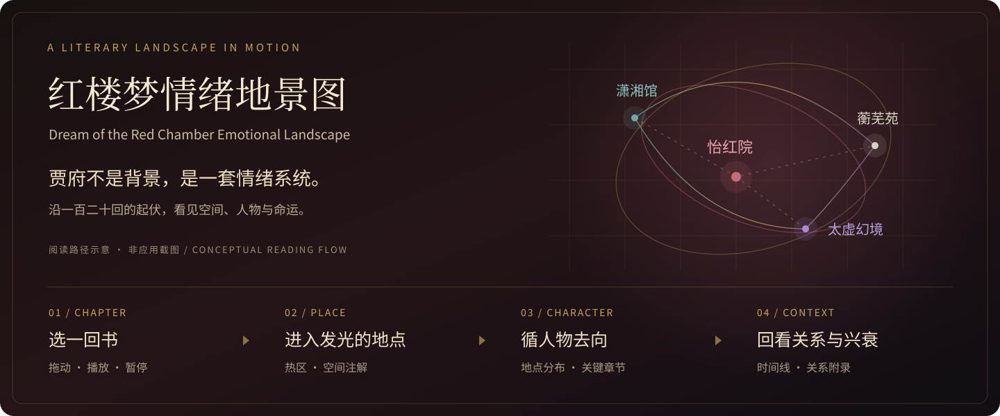

<p align="center">
  
</p>

# 红楼梦情绪地景图

**Dream of the Red Chamber Emotional Landscape**

贾府不是宅院，而是一套由爱、秩序、权力、孤独与命运构成的情绪系统。

这是一个以**空间**重读《红楼梦》的交互式 Web 项目：拖动 1–120 回章节，让地点随叙事发光；沿着人物的出现、聚散与去向，观察同一座园子如何承载不同的情绪。地图是主体验，人物卡、时间线与关系图是辅助阅读层。

[开始体验](#start) · [能探索什么](#explore) · [数据如何解释](#interpretation) · [开发与内容维护](#develop) · [English](#english)

> **阅读提示：包含全书情节与结局信息。** 这是一份解释性的文学可视化，不是原著全文检索、自动情感分析或经考证的建筑复原。上方配图是阅读路径示意，非应用截图。

<a id="explore"></a>
## 从一回书，走进一座园

### 第一次打开，可以这样读

1. **从第 27 回出发。** `/atlas` 默认停在第 27 回，先看章节标题、人物落点与发光地点。
2. **点开一个地点。** 读潇湘馆、怡红院、蘅芜苑等空间的简短解释与命运注解，再回到章节上下文理解它。
3. **让章节流动起来。** 拖动章节条，或使用播放、暂停与 1× / 3× 速度；打开热点面板，比较当前最亮的三个地点。
4. **换一个人物视角。** 点击右上角「人物」，查看主要人物的标注地点分布、关键章节与同回出现人物，并跳回相应地点或章节。

### 不止一张地图

| 阅读入口 | 本地路径 | 可以做什么 |
| --- | --- | --- |
| 章节热力 | `/atlas` | 播放或拖动 120 回，查看地点热度、人物落点与空间注解 |
| 章节时间线 | `/timeline` | 切换前期、中期、后期，查看精选事件及其影响的地点与人物 |
| 人物情绪身份卡 | `/characters` | 按人物、情绪或象征物搜索，进入地图位置或人物关系 |
| 人物关系附录 | `/relations` | 选择人物或关系线，探索亲密、冲突、权力、依赖、误解与命运绑定 |
| 项目说明 | `/about` | 阅读项目的空间叙事理念 |

地图采用 SVG 与 CSS 光影、季节符号和章节特效；关系附录使用 D3 布局。它们服务于阅读与比较，而不是把文学解释变成唯一答案。

<a id="start"></a>
## 本地开始

**环境：Node.js ≥ 20.9.0、npm ≥ 10。** 完整说明见 [REQUIREMENTS.md](REQUIREMENTS.md)。

```bash
git clone https://github.com/yuzhang-zhong/Dream-of-the-Red-Chamber-Emotional-Map.git
cd Dream-of-the-Red-Chamber-Emotional-Map
npm ci
npm run dev
```

打开 **http://localhost:3000/atlas**。首页在 http://localhost:3000 。如果终端提示端口已被占用，请使用它实际输出的地址。

- 不需要数据库、登录系统或外部 AI API key。
- 当前体验由仓库中的结构化内容驱动，没有在线模型推理步骤。
- 首次安装需要下载 npm 依赖；项目使用 `next/font/google` 加载 Geist 字体，编译时也需要能够获取相应字体资源。
- 生产模式请先构建，再启动：

```bash
npm run build
npm run start
```

<a id="interpretation"></a>
## 热度从哪里来？

**“亮”是一种阅读提示，不是客观情绪测量。** 当前实现把编写好的内容与确定性规则组合成可探索的视图：

| 你看到的内容 | 当前实现 | 阅读边界 |
| --- | --- | --- |
| 地点热度 | [地点数据](src/data/atlas.ts)中的关键章节及强度，经[高斯衰减函数](src/lib/atlas.ts)平滑扩散到邻近章节 | 0–100 是视觉强度，不是模型置信度、词频或实测情绪值 |
| 每回人物与地点 | [章节人物映射](src/data/chapter-appearances.ts)：部分章节手工映射、回目别名匹配，未匹配时使用回退人物组；每回最多展示 6 位 | 不是逐句抽取，也不是完整出场名单；默认地点可能是象征性的归属 |
| 人物去向与共现 | [人物统计逻辑](src/lib/character-analytics.ts)汇总上述章节标注 | 百分比和共现次数描述的是项目标注，不代表原著全部活动或真实关系强度 |
| 季节氛围 | [季节规则](src/data/chapter-seasons.ts)根据回目关键词与章节区间推断 | 用于氛围表达，不能当作精确的小说时间考证 |
| 空间、情绪与关系解读 | [基础内容](src/data/atlas.ts)中编写的情绪条目、关系、描述与精选事件 | 是项目的解释框架；地图布局不是地理或建筑测绘，注解也不应直接作为原著引文引用 |

章节导航覆盖 1–120 回，并不意味着每回都有同等密度的人工标注。若用于教学、研究或论证，请回到所采用的原著版本核对情节、原文与章节依据；当前数据也不是带完整文献出处的学术标注集。

<a id="develop"></a>
## 开发与内容维护

### 技术与目录

Next.js **16.2.4** App Router · React **19.2.4** · TypeScript · Tailwind CSS **4** · D3 · Framer Motion · Lucide React

```text
src/
├── app/                     # 页面与只读 API 路由
├── components/
│   ├── atlas/               # 章节播放、园林地图与分析面板
│   ├── characters/          # 可搜索人物卡
│   ├── relations/           # D3 人物关系附录
│   ├── timeline/            # 分期事件时间线
│   └── visual-effects/      # 氛围与视觉层
├── contracts/               # 内容与 API 类型约定
├── data/                    # 地点、人物、关系、回目与推断规则
└── lib/                     # 索引、热度计算与人物统计
scripts/validate-content.ts  # 内容一致性检查
```

内容修改入口：

- [atlas.ts](src/data/atlas.ts)：地点、人物卡、关系、关键事件、情绪图例。
- [chapter-titles.ts](src/data/chapter-titles.ts)：120 回回目。
- [chapter-appearances.ts](src/data/chapter-appearances.ts)：章节人物与地点映射、别名和回退规则。
- [chapter-seasons.ts](src/data/chapter-seasons.ts)：季节推断。

### 检查命令

```bash
npm run validate:content  # ID、引用、数值范围、120 回标题与人物标注覆盖
npm run typecheck        # TypeScript
npm run lint             # ESLint
npm run build            # 生产构建
```

内容校验检查结构与引用一致性，**不验证文学解释或情节准确性**。新增人物或地点时，请同步检查 ID 引用、章节映射和关联关系；提出内容修正时，附上所用版本、回目与原文依据会更有帮助。

### 只读数据接口

本地服务提供 `/api/atlas`、`/api/locations`、`/api/characters`、`/api/relations` 与 `/api/timeline`。响应使用 `data` 与 `meta` 包装，元信息包含 schema 版本、内容版本与生成时间。接口读取仓库内容，不连接外部分析服务。

### 进一步阅读

- [环境要求](REQUIREMENTS.md)：运行前的环境与依赖说明。
- [技术架构文档](TECHNICAL_ARCHITECTURE.md)：设计背景与架构思路；其中的规划应与当前源码区分阅读。
- [AI 图像资产计划](AI_IMAGE_ASSET_PLAN.md)：未来素材方向，**不代表已接入 AI 生成服务或已完成这些资产**。

<a id="english"></a>
## English overview

**Read the novel as a landscape, not only a sequence of events.** This interactive project connects the 120 chapters of *Dream of the Red Chamber* with places, character annotations, curated relationships and visual atmosphere.

Start at `/atlas` to scrub or play through chapters, inspect glowing places, and follow a character's annotated path. Explore `/timeline`, `/characters` and `/relations` for supporting views. The interface and literary commentary are primarily in Chinese; the novel's ending is not hidden.

**Run:** Node.js ≥ 20.9.0 and npm ≥ 10, then `npm ci` and `npm run dev`. Open http://localhost:3000/atlas. No database, account or AI API key is required. Installation needs npm access; compilation also fetches the Geist fonts used by `next/font/google`.

**Interpretation matters:** heat is seeded and smoothed, not inferred by a sentiment model. Character appearances combine manual entries, chapter-title aliases and fallback groups, capped at six per chapter. Character statistics inherit those limits; seasons are heuristic. The map is neither an exhaustive scholarly dataset nor an architectural reconstruction. Check the original text and your chosen edition before using its interpretations as evidence.

The banner above is a conceptual reading-flow illustration, not an application screenshot.
